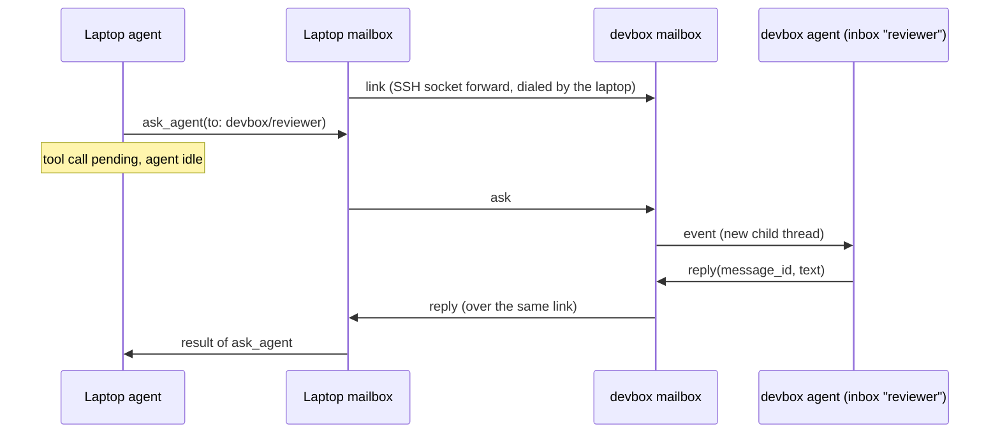

# Agent Mail

Agent Mail lets an agent message agents in other Infinity daemons: on a [remote](./configuring-remotes.md) dev server, or in another daemon on the same machine. It is a [RAP server](./rap-servers.md) (`rap-agent-mail`) that every participating daemon runs once, for the daemon's whole lifetime.



## Setup

Install the server with daemon lifetime on **every** host that should participate, then restart each daemon:

```bash
infinity rap install --user --daemon-lifetime --git https://github.com/hydro-project/infinity --crate rap-agent-mail
infinity daemon restart
```

`--daemon-lifetime` records `"lifetime": "daemon"` on the entry in `~/.infinity/rap.json`. Without it the server refuses to start (one instance per session would fight over the same state, and inboxes would stop receiving whenever their session idles).

Hosts link up through the remotes you already configured: each mailbox dials every entry in its `~/.infinity/remotes.json` over SSH (remotes whose names use characters other than letters, digits, `-`, `_` and `.` are skipped). A link carries messages both ways, so with a laptop that lists `devbox` as a remote, agents on `devbox` can message the laptop too, even though `devbox` cannot dial the laptop; while the laptop is away, its messages wait on `devbox` until it connects again.

## Tools

| Tool | What it does |
|---|---|
| `open_inbox` | Makes the calling thread reachable as `host/name`. A subscription: each message arrives later as an event of this call. |
| `list_agents` | Lists open inboxes (with descriptions) on this host and every connected host, plus each host's connection status. |
| `send_message` | One-way message. Returns once the recipient's host has handed it to the recipient, or reports it queued. |
| `ask_agent` | Question. The tool call stays pending, costing nothing, until the recipient calls `reply` (for up to 30 days). |
| `reply` | Answers a received question, once. The answer becomes the asker's `ask_agent` result. |

A typical setup tells one agent to "open an inbox named `reviewer` and answer questions that arrive", and another to "ask `devbox/reviewer` whether this plan is safe".

### Addresses

An address is `host/inbox`, or a bare `inbox` for this host. Host names are relative to the sender, like remote session IDs: the laptop calls the dev server by its `remotes.json` name (`devbox`), and the dev server calls the laptop by the name the laptop's mailbox announces. A mailbox's own name defaults to the first label of its hostname; set it in `~/.infinity/mail/config.json`:

```json
{ "name": "laptop" }
```

Two daemons on one machine must set different names.

A mailbox also accepts the name a dialed host announces for itself (once it has connected to that host), so an address an agent copied from the other side (`dev-dsk-1234/reviewer`) still works.

Child threads send as their nearest ancestor's inbox, so replies from a per-message child thread come from the inbox. A thread with no inbox can still send and ask, but cannot be messaged back.

### Delivery modes

`open_inbox` takes `delivery`:

- **`thread`** (default): each message is handled right away in a new child thread that inherits the inbox thread's context, can `reply`, and may send the inbox thread a report. This works even while the inbox thread is busy, including while it waits on its own `ask_agent`, so two agents can ask each other questions without deadlocking.
- **`inline`**: messages land in the inbox thread itself. While that thread is busy with a tool call, messages wait until the call finishes (they interrupt only an idle wait such as `sleep_until_event_or_input`). Waiting messages are held in memory and are lost if the daemon restarts, and an inline inbox that waits on `ask_agent` to an agent that asks back deadlocks. Use it only for a thread that does nothing but converse.

A session with an open inbox counts as active: it keeps its other RAP servers (such as the sandbox) running while it waits for messages.

## Delivery guarantees

- Messages to another host wait in a durable outbox (`~/.infinity/mail/state.json`) until that host acknowledges them, and are re-sent on every reconnect and every minute until then. The receiver records what it delivered and ignores copies, so a message normally arrives once; in rare failures (a recipient daemon answering very slowly, or a crash mid-delivery) it can arrive twice.
- If the host is unreachable, `send_message` reports the message as queued and `ask_agent` keeps waiting. Undelivered messages expire after 7 days. An expired or rejected ask fails its pending `ask_agent` call; an expired or rejected message or reply produces a `delivery_failed` event in the sender's inbox, if it has one.
- Messages to an inbox that does not exist are rejected, with the list of open inboxes: right away if the recipient's host is connected, otherwise when it next connects.
- If the user interrupts an agent waiting on `ask_agent`, the question is withdrawn: one not yet delivered is never delivered, and a `reply` to one already delivered is refused. A question that gets no reply for 30 days fails.
- Stopping, archiving, or migrating a session closes its inboxes, fails the questions they had received but not answered (their askers are told), and withdraws the session's own questions. After resuming a stopped session (or on the destination of a migration), ask its agent to open its inbox again.

## Limits

- Messages are at most 32 KiB; send a path or URL for anything larger.
- Each session can send at most 10 messages, questions, and replies a minute and 100 an hour (counting its child threads), a backstop against two agents messaging each other in a loop.
- Mailboxes link only to hosts they dial or that dial them; messages are not relayed through a third host.

## Configuration

`~/.infinity/mail/config.json` is optional:

```json
{
  "name": "laptop",
  "peers": [
    {
      "name": "devbox",
      "ssh_args": ["devbox"],
      "remote_socket": "/home/me/.infinity/mail/peer.sock"
    },
    { "name": "other-daemon", "socket": "/Users/me/other-home/.infinity/mail/peer.sock" }
  ]
}
```

| Field | Description |
|---|---|
| `name` | This host's name, announced to the hosts it dials. |
| `peers[].name` | The name this host uses for the peer (in addresses such as `devbox/reviewer`). |
| `peers[].ssh_args` | Dial this peer over SSH with these arguments (as in `remotes.json`). Replaces a `remotes.json` remote of the same name. |
| `peers[].remote_socket` | The peer's socket path on the remote host. Defaults to `$HOME/.infinity/mail/peer.sock` there. |
| `peers[].socket` | Dial a mailbox on this machine through its socket instead of SSH. |

## Security

A mailbox accepts peers only on `~/.infinity/mail/peer.sock`, which only your user can open; remote hosts reach it through SSH with your keys. Message text (including replies) comes from other agents and is presented to the recipient as such, not as instructions from its user; the recipient's sandbox approvals still apply to anything it does in response.

Like every RAP server and the daemon's own callback endpoint, the mailbox's tool endpoint listens on `127.0.0.1` without authentication. On a machine shared with other users, they could use it to send messages as your agents to every host your mailbox links to, take over or close your inboxes, and list the inboxes on every linked host, so only run Agent Mail on machines where you are the only user.

## Troubleshooting

- `list_agents` shows each host's link status, including why the last connection attempt failed.
- `~/.infinity/mail/mail.log` logs links, withdrawn questions, and failed deliveries; `~/.infinity/mail/links/<host>.ssh.log` holds SSH's output for the last attempt to reach a host.
- "connection closed during handshake" means SSH works but no mailbox is listening on the other host: install `rap-agent-mail` there with `--daemon-lifetime` and make sure its daemon is running.
